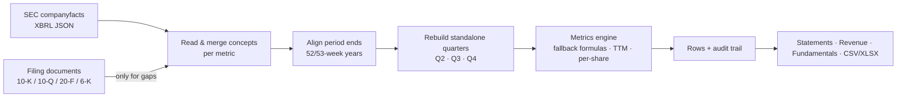

# FilingForge

[](https://github.com/ICL32/filingforge/actions/workflows/ci.yml)


**Clean quarterly, annual and TTM financial statements from SEC EDGAR. Every number shows where it came from.**

FilingForge is a .NET 8 library. Give it a ticker and it gives back the income statement, balance sheet and cash-flow statement as consistent time series: 134 metrics, with standalone quarters, fiscal years and trailing twelve months. Each value records the formula, the SEC concepts and the filing it was built from.

No API key, no database, no paid data vendor. The only input is public data from `sec.gov`.

```text
$ dotnet run --project samples/FilingForge.Samples -- statements AAPL
AAPL: last 8 quarters (USD millions)
Quarter       Revenue       Gross   Operating         Net         FCF
Q1'25         124,300      58,275      42,832      36,330      26,995
Q2'25          95,359      44,867      29,589      24,780      20,881
Q3'25          94,036      43,718      28,202      23,434      24,405
Q4'25         102,466      48,341      32,427      27,466      26,486
Q1'26         143,756      69,231      50,852      42,097      51,552
Q2'26         111,184      54,781      35,885      29,578      26,731
Q3'26         109,417      54,770      35,695      29,789      31,914
Q4'26         114,477      54,820      35,631      30,711      25,859
```

Apple never reports Q4 on its own: it files a 10-K for the full year. The Q4 rows above are rebuilt from the annual report and the three 10-Qs. FilingForge shows exactly how:

```text
$ dotnet run --project samples/FilingForge.Samples -- trace AAPL revenue
Revenue, quarter ending 2026-09-26: 114,477M
  formula     StandaloneQuarterFromAnnual
  concepts    RevenueFromContractWithCustomerExcludingAssessedTax
  filed       2026-11-03  accession 0000320193-26-000026
  input       annual     2026-09-26      478,834M  filed 2026-11-03
  input       q1         2025-12-27      143,756M  filed 2026-01-30
  input       q2         2026-03-28      111,184M  filed 2026-05-01
  input       q3         2026-06-27      109,417M  filed 2026-07-31
```

## Why

SEC's XBRL data (`companyfacts`) is the best free source of company financials, but it is raw:

| Problem in the raw data | What FilingForge does |
|---|---|
| Q4 is only inside the 10-K; some filers only report 6- and 9-month totals | Rebuilds standalone quarters: Q2 = H1 − Q1, Q3 = 9M − H1, Q4 = FY − Q1 − Q2 − Q3 |
| The same line moves between concepts (`Revenues` → `RevenueFromContractWithCustomer…`) | Merges concepts in filing order, so a later restatement replaces the stale figure |
| Old periods get restated | Uses the latest value, and keeps the first-reported value and version history for point-in-time work |
| Some facts never make it into `companyfacts` (foreign 6-K filers, odd cost lines) | Reads the statement tables in the filing documents themselves |
| Weighted-average shares can't be added up | Rebuilds Q4 by share-days and adjusts for stock splits between the nine-month and annual figures |
| Every company tags things differently | Each metric has a priority list of US GAAP / IFRS concepts and fallback formulas |

## Install

FilingForge isn't on NuGet yet. Reference the project directly:

```bash
git clone https://github.com/ICL32/filingforge.git
dotnet add <your-project>.csproj reference filingforge/src/FilingForge/FilingForge.csproj
```

## Use it

```csharp
using FilingForge;

// SEC asks automated clients for a descriptive User-Agent with contact details.
using var sec = new SecEdgarHttpSource("YourApp/1.0 you@example.com");
var client = new FilingForgeClient(sec);

// Income statement, balance sheet and cash-flow highlights per quarter and per year.
var statements = await client.GetStatementsAsync("AAPL");

// Every metric for every period, plus an audit row per value.
var metrics = await client.GetMetricsAsync("AAPL");
foreach (var row in metrics.Rows)
{
    var quarter = row.Quarterly["revenue"].Value;   // standalone quarter
    var ttm     = row.Ttm["revenue"].Value;         // trailing twelve months
}

// Quarterly / TTM revenue with year-over-year growth.
var revenue = await client.GetRevenueAsync("MSFT");

// Spreadsheet export: data sheet, audit sheets and metric definitions.
var exporter = new FinancialMetricsExportService(client);
await File.WriteAllBytesAsync("financials.xlsx", await exporter.BuildXlsxAsync(["AAPL", "MSFT"]));
```

More in **[docs/usage.md](docs/usage.md)**: the result types, provenance fields, exports, and plugging in your own data source or cache.

## How it works



The full walkthrough, covering concept priority, restatements, quarter reconstruction, the filing-document fallback, TTM rules and validation, is in **[docs/how-it-works.md](docs/how-it-works.md)**.

## What's covered

134 metrics (76 flow, 58 point-in-time), all listed in **[docs/metrics.md](docs/metrics.md)**:

- **Income statement:** revenue, cost of revenue, gross profit, operating expenses, EBIT, pretax income, tax, net income, basic/diluted EPS, weighted-average shares, per-share lines.
- **Cash flow:** operating cash flow, capex, free cash flow, buybacks, dividends, debt issuance and repayment, stock-based compensation, and more.
- **Balance sheet:** cash and investments, receivables, inventory, assets, goodwill and intangibles, PP&E, debt and leases, liabilities, equity, shares outstanding.

Works for US GAAP filers (10-K/10-Q) and IFRS foreign filers (20-F/40-F/6-K).

## Repository layout

```
src/FilingForge/              the library
  FilingForgeClient.cs        start here
  Sec/                        SEC access, companyfacts reader, filing-document parser
  Financials/                 metric catalog, quarter and TTM builders, statements
  Exporting/                  CSV / XLSX / trace export
samples/FilingForge.Samples/  runnable examples (statements, metric, trace, export)
tests/FilingForge.Tests/      tests, fixture company, output snapshots
docs/                         usage, how it works, metric reference
```

## Development

```bash
dotnet run --project tests/FilingForge.Tests -c Release
FILINGFORGE_USER_AGENT="dev you@example.com" dotnet run --project samples/FilingForge.Samples -- statements MSFT
```

`tests/FilingForge.Tests/Snapshots` holds the full metric output for a fixture company. If you change the output on purpose, run the tests with `UPDATE_SNAPSHOTS=1` and review the diff. After changing the catalog, regenerate the metric reference with `dotnet run --project samples/FilingForge.Samples -- metrics-doc docs/metrics.md`.

## Limitations

- **TTM EPS is not split-adjusted.** Summing four quarters that span a stock split mixes the pre- and post-split share bases. Use TTM net income ÷ shares around splits.
- Values read from filing documents (rather than XBRL) rely on table-parsing heuristics. They are labelled `filing-table` / `filing-text` in `SourceType` so you can filter them out.
- A rebuilt diluted-share Q4 is approximate, because dilution is measured per period.
- Data is only as good as the filings. Check anything important against the source document, whose accession number is on every value.

FilingForge is not investment advice.

## License

[MIT](LICENSE)
