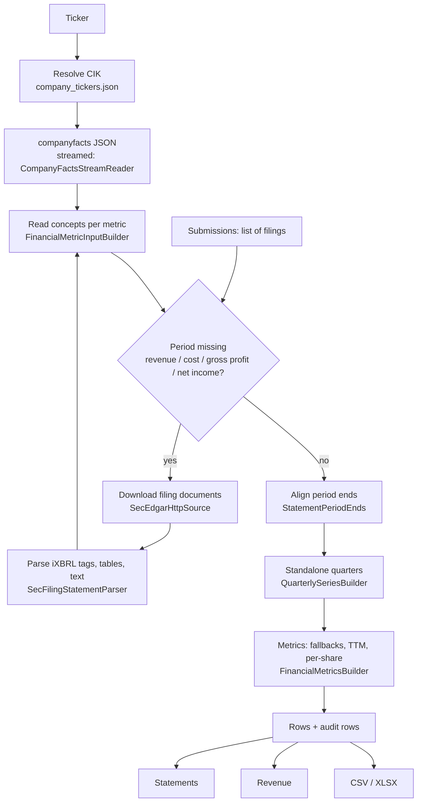

# How FilingForge works

This guide follows one ticker through the engine, from raw SEC data to finished statements. File names refer to `src/FilingForge/`.



## 1. Reading SEC's data

SEC's `companyfacts` endpoint returns every XBRL fact a company has filed: one entry per concept, unit, period and filing. For a large company that's 20–100 MB of JSON. `CompanyFactsStreamReader` streams it and keeps only facts from financial forms (10-K, 10-Q, 20-F, 40-F, 6-K and their amendments), so memory stays small.

Each fact becomes a `FinancialPoint`: start date, end date, value, form, filing date, concept, fiscal year and period, accession number.

## 2. Choosing concepts for each metric

Companies tag the same thing differently, and change tags over time. Each metric in `FinancialMetricsCatalog` lists:

- **direct concepts**, in priority order, separately for US GAAP and IFRS. For cost of revenue: `CostOfGoodsAndServicesSold` → `CostOfGoodsSold` → `CostOfRevenue`;
- **fallback formulas** used when no direct concept has a value. For cost of revenue: revenue − gross profit, then revenue − operating income − operating expenses.

When several facts describe the same period, `FinancialPointMerger` and `FinancialPointSelection` pick one. Rules include: a later filing beats an earlier one (restatements win), higher precision beats a rounded summary, and the more trusted source beats the less trusted one (see `SourceType` in [usage.md](usage.md#provenance-where-each-number-came-from)).

When a value is restated, the earlier versions are kept in `FinancialPoint.Versions`, and the first filing date in `FirstFiled`. That lets you ask what was known on a given date, which matters for backtests.

### Revenue is special

Revenue concepts changed when ASC 606 arrived, and many companies switched from `Revenues` or `SalesRevenueNet` to `RevenueFromContractWithCustomer…`. FilingForge merges all revenue concepts **in filing order**, so a restated comparative filed under the new concept replaces the old figure for that period. Two more cases are handled:

- **Landlords** (REITs) whose main revenue is lease income tagged `OperatingLeaseLeaseIncome`: it is used when it is clearly the real top line, rather than a small non-lease remainder.
- **Banks**, which have no "revenue" tag: net revenue is built as net interest income + non-interest income.

## 3. Filling gaps from filing documents

Some numbers never reach `companyfacts`. This is common for foreign filers who report quarterly results in 6-K press releases, and for companies whose income statement lists several cost lines but no cost-of-revenue total.

For each recent filing (up to 72), FilingForge checks whether revenue, cost of revenue, gross profit and net income are all present for that report date. Only if something is missing does it fetch the filing:

- **10-K / 10-Q:** the primary document only.
- **6-K, 20-F and others:** the complete submission, keeping only the HTML documents that mention revenue or net income (usually the EX-99 press release).

`SecFilingStatementParser` then reads three kinds of content:

1. **Inline XBRL tags** (`ix:nonFraction`) for the main concepts. Tags whose context has a dimension (segment, product, region) are skipped, since those aren't consolidated totals.
2. **HTML statement tables.** Column headers ("Three Months Ended March 31, 2026") give the periods, row labels map to concepts ("Total revenues", "Cost of sales", "Net income"), and "in thousands" / "in millions" sets the scale. Non-GAAP tables ("adjusted", "EBITDA", reconciliations) are skipped.
3. **Statement text**, for filings that put the statement in running text instead of a table.

If an income statement has no cost-of-revenue line but lists cost items ("Cost of product", "Cost of cloud services"…) at the top of its expense section, their absolute sum becomes cost of revenue for each period where every item has a value. These values are tagged `filing-table-derived`. Gross profit is then revenue minus that cost, because a reported gross-profit tag in such filings may cover only one segment.

## 4. Aligning period ends

Retailers and chip makers often use 52/53-week years, so "the quarter ending" falls on a different date each year (Dec 30, Dec 28, Jan 1…), and a filing may tag the same period a day or two apart. `StatementPeriodEnds` snaps facts onto the company's actual statement period ends, so quarters line up across concepts and years. `FiscalCalendar` labels each period with the company's own fiscal year and quarter.

## 5. Building standalone quarters

Flow items (revenue, net income, cash flow) are often reported only as year-to-date totals. `QuarterlySeriesBuilder` turns them into standalone quarters:

| Quarter | Rule | `Formula` |
|---|---|---|
| reported | three-month fact as filed | `DirectFact` |
| Q2 | six months − Q1 | `StandaloneQuarterFromH1` |
| Q3 | nine months − six months, or nine months − Q1 − Q2 | `StandaloneQuarterFrom9M` |
| Q4 | full year − Q1 − Q2 − Q3, or full year − nine months | `StandaloneQuarterFromAnnual` |

Safeguards:

- **As-known annuals.** If a later 10-K restated the year but the quarters were never restated, Q4 uses the annual figure **as it was when the quarters were filed**. Otherwise the restatement would end up entirely in Q4.
- **No near-duplicates.** A quarter is never rebuilt within ten days of one that was reported directly (52/53-week boundaries can differ by a day).
- **Mislabelled annuals.** A three-month fact in a 10-K that equals the annual total (a known tagging error) is ignored.
- Each rebuilt quarter keeps its inputs, so you can see `annual − q1 − q2 − q3` with every filing date.

### Weighted-average shares

Average share counts aren't sums, so Q4 = year − 9M would be meaningless. `WeightedAverageShareQuarterBuilder` uses share-days instead:

```
Q4 average = (FY average × FY days − 9M average × 9M days) ÷ Q4 days
```

If the full-year and nine-month averages differ by more than a factor of 1.5, a stock split probably happened in Q4. The nine-month figure is then multiplied by the split ratios that the company reported (`StockholdersEquityNoteStockSplitConversionRatio1`) between the two period ends. If no reported split explains the gap, Q4 is left empty rather than guessed. Rebuilt diluted Q4 counts are approximate, because dilution is measured per period.

## 6. Computing metrics

`FinancialMetricsBuilder` produces the four views for every period:

- **Quarterly:** the standalone quarter. Direct concept first, then the metric's fallback formulas (e.g. free cash flow = operating cash flow − capex; gross profit = revenue − cost of revenue).
- **Annual:** fiscal-year values, set on fiscal-year-end rows.
- **TTM:** the sum of the latest **four consecutive** standalone quarters. Consecutive means period ends about 13 weeks apart, so a gap leaves TTM empty instead of summing the wrong window. Some metrics may take an exact twelve-month SEC fact when no clean window exists (`DirectTtmFact`). Share counts carry the quarter's own value rather than summing.
- **Point:** balance-sheet values at the period end. Signs follow presentation conventions (costs positive, cash outflows negative where the statement shows them so).

Per-share metrics (revenue, gross profit, operating income… per basic and diluted share) are computed last, in each view, from the finished numerator and share count.

Every value records its formula, concepts, filing dates and inputs. Those records become the audit rows.

## 7. Validation

Each period row carries a `ValidationStatus`:

- `ok`: no issues found.
- `warning`: something didn't reconcile. Messages are codes such as `ttm_does_not_match_annual` (four quarters don't add up to the reported year), `negative_revenue` or `duplicate_period_selected`.
- `error`: the ticker failed entirely (exports only).

Validation never changes a value; it only flags it.

## What FilingForge does not do

- **Market data:** no prices, so no P/E or market cap. Combine the per-share and TTM values with your own prices.
- **Segment or geographic breakdowns:** consolidated totals only.
- **Split-adjusted EPS history:** EPS is shown as reported, so TTM EPS across a split mixes share bases.
- **Non-SEC filers.**
